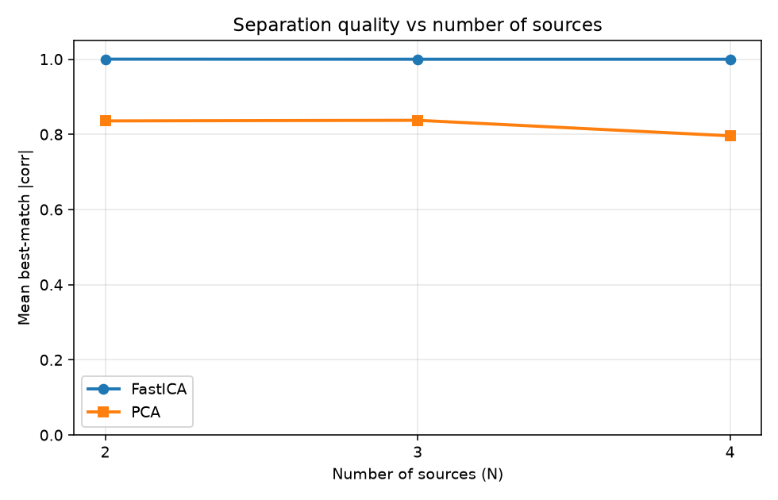
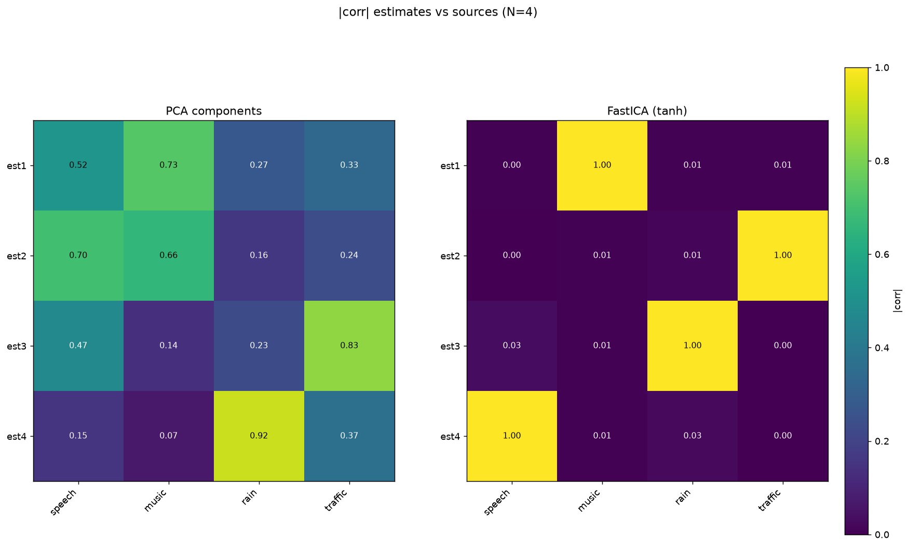
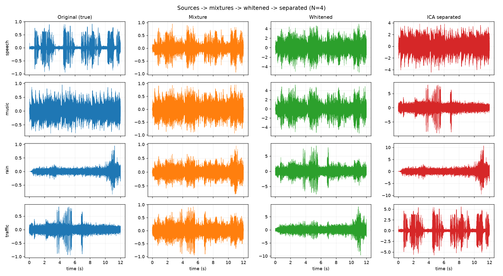
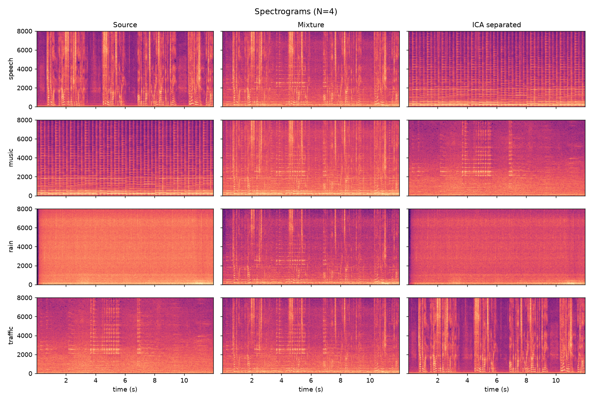
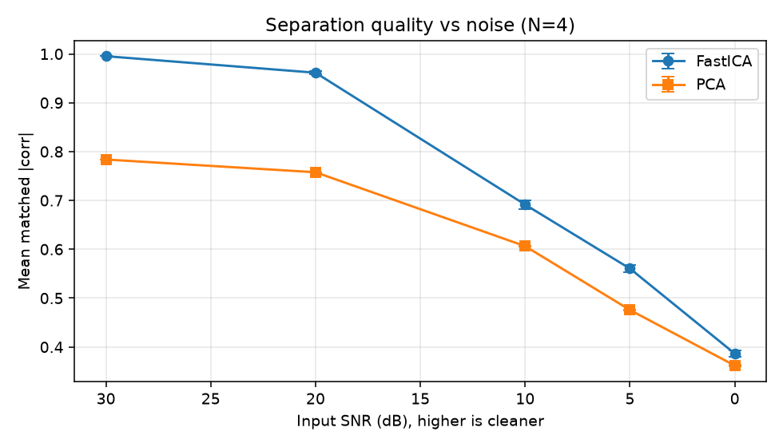
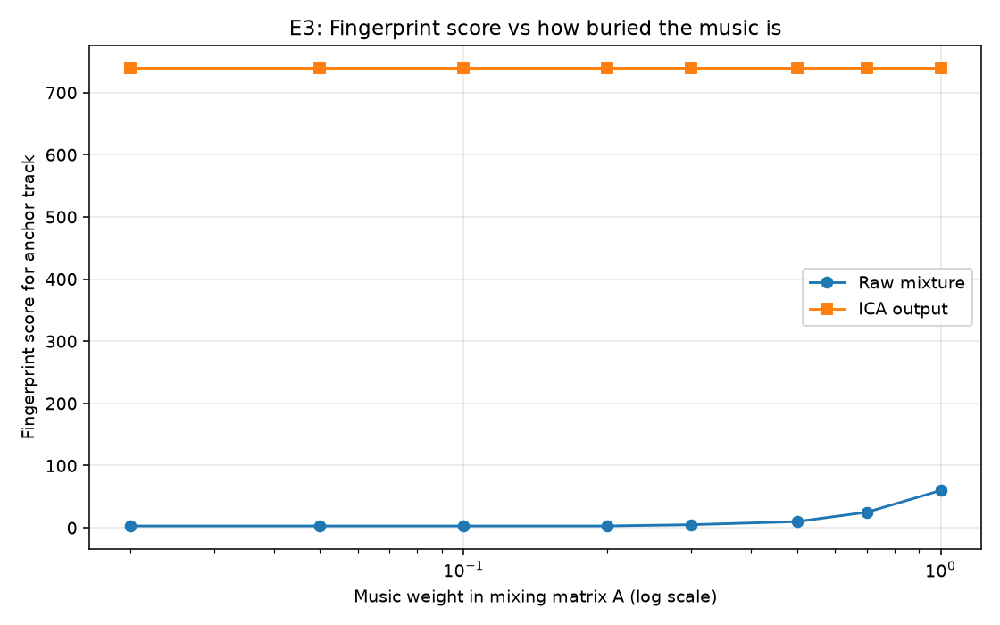
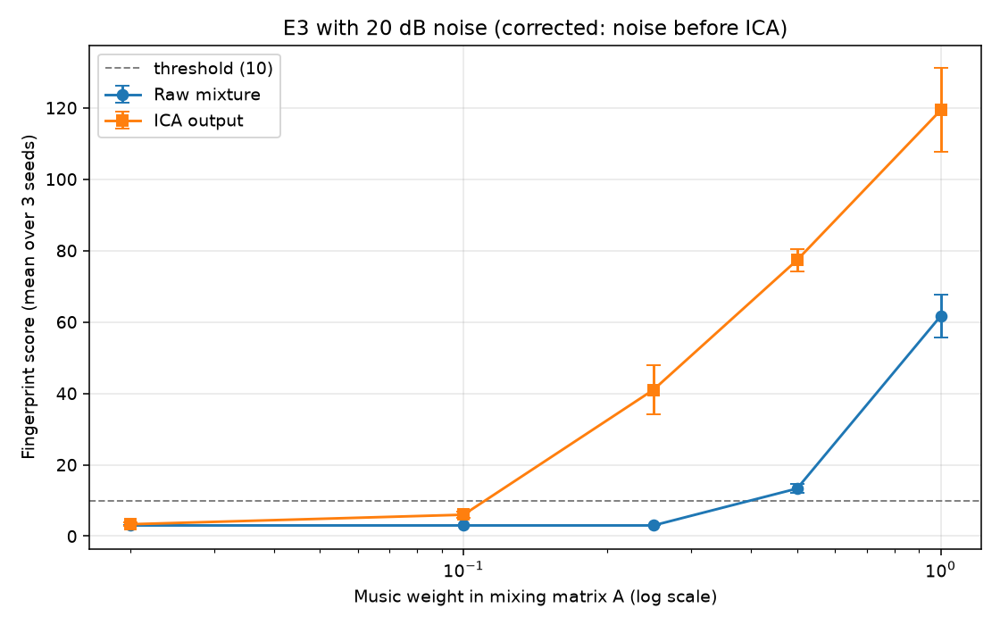
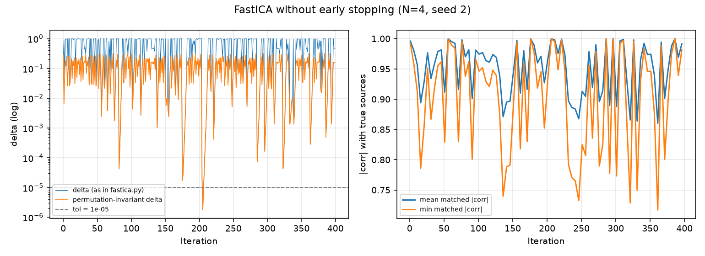

# Unmix the Signal: ICA from Scratch

A from-scratch implementation of Independent Component Analysis (FastICA) that recovers clean audio sources from mixed recordings, without knowing the mixing matrix or which output belongs to which source. A mini-Shazam audio fingerprinter, also written from scratch, gives an independent check that the separation really improved the signal.

**Highlights**

- **PCA whitening and FastICA are implemented from scratch.** No library ICA is used anywhere in the implementation.
- **Works for any number of sources N.** Evaluated at N = 2, 3 and 4 with speech, music, rain and traffic.
- **FastICA recovers every source at every N**, with mean best-match |corr| = 1.000. PCA, scored the same way, reaches only 0.80 to 0.84 and its worst component gets worse as N grows.
- **Mini-Shazam confirms the separation.** At default weights the ICA output scores 739 against 60 for the raw mixture and 16 for PCA. When the music is buried under noise, ICA keeps identifying the song one weight step longer than the raw mixture.
- **Honest limitations are documented**, including a convergence problem with the tanh nonlinearity (section 6) and an experiment bug that I found, fixed and reran (section 7).

---

## Contents

1. [Overview](#1-overview)
2. [Why ICA, and why it works](#2-why-ica-and-why-it-works)
3. [Pipeline in detail](#3-pipeline-in-detail)
4. [Audio sources and audio files](#4-audio-sources-and-audio-files)
5. [Results](#5-results)
6. [Convergence and stability](#6-convergence-and-stability)
7. [Bugs found and fixed](#7-bugs-found-and-fixed)
8. [Limitations](#8-limitations)
9. [Where to find every output](#9-where-to-find-every-output)
10. [Repository layout](#10-repository-layout)
11. [How to run](#11-how-to-run)
12. [What I learned](#12-what-i-learned)
13. [Environment and license](#13-environment-and-license)

---

## 1. Overview

Given N mixed audio recordings produced by an unknown N x N mixing matrix `A` from N unknown sources, recover the sources. This is the classic "cocktail party problem".

The pipeline:

1. Prepare N clean sources (speech, music, rain, traffic) at 16 kHz mono, 12 seconds each.
2. Mix them with my own N x N matrix to create N mixtures.
3. Center the mixtures (zero mean).
4. Whiten them with PCA written from scratch (covariance, eigendecomposition, rescaling).
5. Recover the sources with FastICA written from scratch (tanh nonlinearity, symmetric decorrelation, 5 random restarts).
6. Export the separated signals as playable WAV files.
7. Evaluate against the originals with absolute Pearson correlation, solving the permutation ambiguity by optimal matching (Hungarian algorithm).
8. Repeat at N = 2, 3 and 4 and compare with PCA.
9. Verify the separation independently with a from-scratch audio fingerprinter.

---

## 2. Why ICA, and why it works

**PCA uses second-order statistics** (variance and covariance). It finds directions of maximum variance and produces *uncorrelated* components. Uncorrelated is not the same as independent, so PCA decorrelates the mixtures but does not separate them. After whitening, every rotation of the data is equally valid as far as second-order statistics go, and PCA has no way to choose the right one.

**ICA uses higher-order statistics** (such as kurtosis, a measure of non-Gaussianity). By the Central Limit Theorem, a mixture of independent random variables tends to be *more Gaussian* than any of its components. So the directions in which the data is *least* Gaussian are the directions where one source dominates, and ICA looks for them.

**Whitening helps ICA** because it removes the second-order structure. The unknown shrinks from "any N x N matrix" to "an orthogonal matrix (a rotation)", which is a much smaller search space.

**ICA has three ambiguities:** the order of the outputs (permutation), their scale, and their sign. The evaluation handles all three (section 3.5).

---

## 3. Pipeline in detail

### 3.1 Mixing

The sources are stacked into an `(N, T)` matrix `S`. The mixing matrix `A` has 1.0 on the diagonal and 0.5 off the diagonal, giving `X = A @ S`. Each mixture therefore contains all sources at different weights, and `A` is well conditioned. Each mixture is then scaled to a peak amplitude of 0.95 before it is saved.

### 3.2 Centering

The mean of each signal is subtracted so that every row of `X` has zero mean. ICA assumes zero-mean signals.

### 3.3 PCA whitening (from scratch)

Compute the empirical covariance and its eigendecomposition:

```text
C = (1/T) * Xc @ Xc.T              (N x N)
C = E @ diag(lambda) @ E.T
```

Build the whitening matrix and apply it:

```text
W_white = diag(1 / sqrt(lambda)) @ E.T
Z = W_white @ Xc
```

After whitening, `Cov(Z)` is the identity matrix. I checked this numerically.

### 3.4 FastICA (from scratch)

The fixed-point update for each component `w`, with `g(u) = tanh(u)`:

```text
w+ = E[ z * g(w.T z) ] - E[ g'(w.T z) ] * w
```

Symmetric decorrelation keeps all components orthogonal while they are estimated together:

```text
W <- (W W.T)^(-1/2) @ W
```

I run **5 random restarts** and keep the one with the highest total absolute excess kurtosis of its components. The iteration stops when the change in `W` between iterations drops below `1e-5`, or after 2000 iterations. See section 6 for how this behaves in practice.

### 3.5 Evaluation

Because ICA has permutation, scale and sign ambiguities, the evaluation does the following:

1. Compute the N x N matrix of **absolute Pearson correlations** between the estimates and the true sources. Correlation ignores scale, and the absolute value ignores sign.
2. Solve the optimal one-to-one assignment with `scipy.optimize.linear_sum_assignment` (the Hungarian algorithm), which resolves the permutation.
3. Report the mean and the minimum matched |corr| across sources.

PCA is scored with exactly the same metric, so the comparison is fair.

---

## 4. Audio sources and audio files

### 4.1 Sources for the ICA experiments

All clips are converted to 16 kHz mono and trimmed to 12 seconds. The cleaned clips are in [`audio/`](audio/).

| Source | Cleaned clip |
|---|---|
| speech | [speech.wav](audio/speech.wav) | 
| music | [music.wav](audio/music.wav) |
| rain | [rain.wav](audio/rain.wav) | 
| traffic | [traffic.wav](audio/traffic.wav) | 

### 4.2 Fingerprint library (7 tracks)

The tracks used to build the fingerprint database are in [`library/`](library/) (originals) and `library/wav/` (16 kHz mono). The table lists where each one came from and under what license.

| Track | Role |
|---|---|
| anchor_track | The song the "music" source was cut from |
| drums | Decoy | 
| electronic | Decoy | 
| guitar | Decoy | 
| piano | Decoy |
| saxophone | Decoy | 
| violin | Decoy | 

### 4.3 Mixed and separated audio

GitHub cannot play audio inside a README, so each file below opens on its own page, where it can be played or downloaded.

| N | Mixtures (input to ICA) | Separated by FastICA |
|---|---|---|
| 2 | [mix1](outputs/N=2/mix1.wav), [mix2](outputs/N=2/mix2.wav) | [separated_1](outputs/N=2/separated_1.wav), [separated_2](outputs/N=2/separated_2.wav) |
| 3 | [mix1](outputs/N=3/mix1.wav), [mix2](outputs/N=3/mix2.wav), [mix3](outputs/N=3/mix3.wav) | [separated_1](outputs/N=3/separated_1.wav), [separated_2](outputs/N=3/separated_2.wav), [separated_3](outputs/N=3/separated_3.wav) |
| 4 | [mix1](outputs/N=4/mix1.wav), [mix2](outputs/N=4/mix2.wav), [mix3](outputs/N=4/mix3.wav), [mix4](outputs/N=4/mix4.wav) | [separated_1](outputs/N=4/separated_1.wav), [separated_2](outputs/N=4/separated_2.wav), [separated_3](outputs/N=4/separated_3.wav), [separated_4](outputs/N=4/separated_4.wav) |

The order of the separated files is arbitrary, because ICA cannot know it. At N = 4 the matching is: `separated_1` is music, `separated_2` is traffic, `separated_3` is rain and `separated_4` is speech. The matching for N = 2 and N = 3 is in each `outputs/N=<n>/results.md`.

---

## 5. Results

### 5.1 Separation quality across N

| N | PCA mean \|corr\| | PCA min \|corr\| | FastICA mean \|corr\| | FastICA min \|corr\| |
|---|---|---|---|---|
| 2 | 0.836 | 0.835 | **1.000** | **1.000** |
| 3 | 0.837 | 0.783 | **1.000** | **1.000** |
| 4 | 0.796 | 0.697 | **1.000** | **0.999** |

- FastICA recovers all sources at every N.
- PCA does not separate. Its mean stays between 0.80 and 0.84, but its **worst** component falls from 0.835 at N = 2 to 0.697 at N = 4: the more sources there are, the more mixed each PCA component becomes.
- PCA's score depends on how the mixtures are scaled, because PCA only looks at variance. FastICA's result does not depend on scaling. The numbers above use the mixtures as saved by `make_mixtures.py` (scaled to a 0.95 peak). The scripts that call `run_pipeline` (SNR sweep, Shazam, E3) do not rescale, so their PCA values differ slightly. FastICA values are identical either way.



**N = 4 correlation matrices** (rows are estimates, columns are the true sources). FastICA has a clean diagonal; every PCA component correlates with several sources.

```text
FastICA                                  PCA
        speech  music   rain  traffic            speech  music   rain  traffic
est1    0.004   1.000  0.006  0.006      est1    0.520   0.734  0.275  0.335
est2    0.001   0.006  0.014  1.000      est2    0.697   0.661  0.161  0.236
est3    0.003   0.006  1.000  0.002      est3    0.471   0.139  0.233  0.834
est4    1.000   0.007  0.011  0.000      est4    0.149   0.069  0.919  0.370
```



Heatmaps for the other values of N: [N=2](outputs/N=2/figures/correlation_heatmaps.png) and [N=3](outputs/N=3/figures/correlation_heatmaps.png).

**Waveforms (N = 4).** From left to right: the original sources, the mixtures, the whitened signals and the signals recovered by FastICA.



**Spectrograms (N = 4).** Sources, mixtures and recovered signals. The frequency signature of each source reappears in the recovered signals.



The same figures for [N=2](outputs/N=2/figures/waveforms.png) and [N=3](outputs/N=3/figures/waveforms.png) are in the `outputs/N=<n>/figures/` folders.

### 5.2 Robustness to noise (SNR sweep)

Gaussian noise is added to the mixtures at the stated SNR **before** centering, whitening and FastICA. Mean matched |corr| at N = 4, averaged over 3 seeds:

| SNR (dB) | FastICA | PCA |
|---|---|---|
| 30 | 0.996 | 0.784 |
| 20 | 0.954 ± 0.015 | 0.758 |
| 10 | 0.691 ± 0.009 | 0.606 |
| 5 | 0.560 ± 0.008 | 0.476 |
| 0 | 0.386 ± 0.006 | 0.362 |

FastICA stays above 0.95 down to 20 dB, then degrades steadily. It is better than PCA at every noise level, but at 0 dB the gap is small. At N = 2 (speech and music only) the same sweep stays higher: 0.999, 0.986, 0.889, 0.752 and 0.566 at the same SNRs, so more sources makes noise more damaging.



Full table: [`outputs/snr_sweep_results.md`](outputs/snr_sweep_results.md).

### 5.3 Independent check with a mini-Shazam

Correlation is a single number and could mislead. To get independent evidence, I built an audio fingerprinter that identifies *which song* is playing in a short clip. If it identifies the right song in the ICA output with a much stronger score than in the raw mixture, the separation really did improve the signal.

**Algorithm**

1. Spectrogram with `scipy.signal.spectrogram` (`nperseg=512`, 50% overlap, log magnitude).
2. Peaks: local maxima in a 15 x 15 neighbourhood above the 90th percentile.
3. Pair hashing: each anchor peak is paired with the next few peaks, giving the hash `(freq1, freq2, time_gap)`.
4. Database: a dictionary from each hash to a list of `(song, anchor_time)`.
5. Matching: every query hash votes for `(song, t_db - t_query)`. The true song produces many votes at a single offset. The score of a song is its tallest vote spike.

The database holds 33,848 unique hashes from 7 tracks: the anchor track and 6 decoys of different genres.

**Self-test.** A 5-second clip from the middle of each library song:

| Query | Best match | Score | Result |
|---|---|---|---|
| anchor_track | anchor_track | 500 | correct |
| drums | drums | 749 | correct |
| electronic | electronic | 568 | correct |
| guitar | guitar | 560 | correct |
| piano | piano | 504 | correct |
| saxophone | saxophone | 498 | correct |
| violin | violin | 362 | correct |

7 of 7 are rank 1. A score of 1 to 3 is a random collision, so I call a song **identified** only when it is rank 1 and its score is at least 10.

**Predictions on the separated audio (N = 4, default weights).** The music component is chosen by the highest fingerprint score of the four outputs. Ground truth is never used for this choice.

| Output | Best score for the anchor song |
|---|---|
| Raw mixtures (best of 4) | 60 |
| PCA components (best of 4) | 16 |
| FastICA components (best of 4) | **739** |

The winning score on the ICA output is about 12 times the raw mixture's and about 46 times PCA's. The raw mixture is still identified at default weights, so identification alone does not prove ICA is needed. The next experiment tests this directly.

**E3: how deeply can the music be buried?** I scale down the music column of `A` and check whether the right song is still identified, for the raw mixture and the ICA output (3 seeds per cell).

*Without noise:*

| Music weight in A | Mix top-1 | Mix score | ICA top-1 | ICA score | ICA \|corr\| to music |
|---|---|---|---|---|---|
| 1.00 | 1.00 | 60.0 | 1.00 | 739.0 | 1.000 |
| 0.50 | 1.00 | 10.0 | 1.00 | 739.0 | 1.000 |
| 0.25 | 0.00 | 3.0 | 1.00 | 739.0 | 1.000 |
| 0.10 | 0.00 | 3.0 | 1.00 | 739.0 | 1.000 |
| 0.02 | 0.00 | 3.0 | 1.00 | 739.0 | 1.000 |

Without noise, the raw mixture stops identifying the song at weight 0.25, while ICA still identifies it at 0.02, the lowest weight tested. The ICA score is identical in every row because FastICA recovers the music up to scale and the fingerprinter does not depend on scale.

*With 20 dB noise* (noise added before FastICA, mean ± std over 3 seeds):

| Music weight | Mix top-1 | Mix score | ICA top-1 | ICA score | ICA \|corr\| to music |
|---|---|---|---|---|---|
| 1.00 | 1.00 | 61.7 ± 6.0 | 1.00 | 119.3 ± 11.7 | 0.983 |
| 0.50 | 1.00 | 13.3 ± 1.2 | 1.00 | 77.3 ± 3.1 | 0.970 |
| 0.25 | 0.00 | 3.0 ± 0.0 | 1.00 | 41.0 ± 7.0 | 0.924 |
| 0.10 | 0.00 | 3.0 ± 0.0 | 0.00 | 6.0 ± 0.8 | 0.721 |
| 0.02 | 0.00 | 3.0 ± 0.0 | 0.00 | 3.3 ± 0.5 | 0.207 |

With noise, the raw mixture fails at weight 0.25 and ICA fails at 0.10, so ICA's advantage shrinks to **one weight step**. The ICA score and the ICA correlation to the true music fall together, which confirms that the degradation is real. Noise eventually defeats both methods.





Tables: [`e3_results.md`](outputs/e3_results.md) and [`e3_noise_results.md`](outputs/e3_noise_results.md).

---

## 6. Convergence and stability

FastICA has no training loss, so there is no loss curve. The closest equivalent is the **change in the unmixing matrix between iterations** (`delta`), which is also the stopping criterion, together with the restart-selection score.



*Left: delta per iteration for the plain metric and for a permutation-invariant version. Right: matched |corr| with the true sources, over 400 iterations with no early stopping (N = 4, seed 2).*

What this shows:

- **With the tanh nonlinearity, the iteration does not settle on this data.** It reaches the correct solution (matched |corr| touches 1.000) and then drifts away again, repeatedly. Delta does not decay smoothly toward the tolerance.
- **The stopping rule is satisfied only when the iterate lands on the solution.** In the runs used for the results, delta dropped below `1e-5` at such a moment, and the result was checked against the true sources (|corr| of 1.000 and 0.999). The iteration counts in the logs (for example 84 to 1,701 at N = 4) therefore measure how long it took to land on the solution, not a convergence speed.
- **The heavy-tailed sources (speech, rain, traffic) are the ones that wander.** Music, which is close to Gaussian (excess kurtosis 0.15), stays at 1.000.
- **Probable cause (not proven):** FastICA's update uses an approximation for the curvature term, and tanh may be a poor fit for these bursty, heavy-tailed sources.
- **Next step, not done here:** try other nonlinearities (Gaussian or cubic) and rerun the experiments.

Because the result depends on the iteration landing on the solution, a run that hit the iteration cap would return an arbitrary state. The runs here were verified against ground truth, which would not be available in real use.

Logs for each N are in [`outputs/logs/`](outputs/logs/). The per-restart convergence plots are in `outputs/N=<n>/figures/convergence.png`.

---

## 7. Bugs found and fixed

**Flat restart score at N = 4.** The first restart-selection score was `mean(tanh(w.T z))^2`, which is about 0 for any zero-mean signal, so all five restarts printed a score near 0.0001 and the "best restart" logic chose arbitrarily. I diagnosed it by computing the correlation matrix against the ground truth: separation was already perfect, and only the score was broken. I replaced it with a kurtosis-based score.

**Damping hurt instead of helping.** I added a damped update `W <- 0.2*W_old + 0.8*W_step` to stabilise FastICA at N = 4. Mean |corr| fell from about 1.0 to 0.84. I measured the effect and reverted the change.

**Stale-folder bug.** Early scripts picked the last `outputs/N=*/` folder. After `sources.txt` was edited from four sources to two, they tried to plot four. N is now read from `sources.txt`, and every script uses `outputs/N=<n>/`.

**Noise added after FastICA (E3, major).** My first noisy E3 run gave an identical ICA score (739.0 ± 0.0) in every cell. That was too clean to be true: the pipeline ran on clean data, and noise was added only to the raw-mixture branch, so ICA never saw it. A review caught it. I moved the noise inside `run_pipeline(snr_db=...)`, so it is added before centering, whitening and FastICA for both branches, and reran. The corrected result is more modest than the original claim, and it is the one reported above.

Smaller issues, such as an unactivated virtual environment, misplaced raw files and a Windows encoding error, are not listed here.

---

## 8. Limitations

- **Instantaneous linear mixing only.** Real recordings have echoes and delays, which break this assumption. I skipped real multi-device recordings for that reason.
- **The tanh iteration does not settle** on this data (section 6). The results hold because they were checked against the true sources.
- **Small library.** The fingerprint library has 7 tracks, and the anchor song is in it by design, so the check asks whether the fingerprinter finds the anchor, not whether it can identify arbitrary songs.
- **One correlation-based metric.** I did not add SI-SDR, and I did not cross-check against a library implementation of FastICA.
- **Choosing the best of N outputs by fingerprint score** slightly favours every method that is evaluated this way.
- **Source choice matters more than N.** The sources used here are statistically distinct. Two similar voices would be much harder to separate.

---

## 9. Where to find every output

| What | Where |
|---|---|
| Evaluation metrics per N | [`outputs/comparison.md`](outputs/comparison.md) and `outputs/N=<n>/results.md` |
| Noise robustness | [`outputs/snr_sweep_results.md`](outputs/snr_sweep_results.md) |
| Fingerprint predictions | [`outputs/e3_results.md`](outputs/e3_results.md), [`outputs/e3_noise_results.md`](outputs/e3_noise_results.md) |
| Convergence logs | [`outputs/logs/`](outputs/logs/) |
| Figures (all) | [`outputs/figures/`](outputs/figures/) and `outputs/N=<n>/figures/` |
| Mixed and separated audio | `outputs/N=<n>/mix*.wav`, `outputs/N=<n>/separated_*.wav` |

---

## 10. Repository layout

```text
unmix-signal-ica/
├── sources.txt              one source name per line; controls N
├── raw_<name>.mp3           raw input recordings
├── audio/<name>.wav         cleaned 16 kHz mono sources
├── library/                 fingerprint library tracks
│   └── wav/                 the same tracks as 16 kHz mono WAV
├── outputs/
│   ├── N=2/, N=3/, N=4/     mixtures, separated audio, saved arrays, results, figures
│   ├── fingerprint_db.pkl   pickled fingerprint database
│   ├── logs/                convergence logs
│   ├── figures/             cross-N and experiment figures
│   ├── comparison.md        summary across N
│   ├── snr_sweep_results.md
│   ├── e3_results.md
│   └── e3_noise_results.md
├── prepare_audio.py         raw files to 16 kHz mono WAV
├── make_mixtures.py         build mixtures with my own A
├── whiten.py                centering and PCA whitening from scratch
├── fastica.py               FastICA from scratch with restarts
├── evaluate.py              matching and correlation metrics
├── make_plots.py            waveform, spectrogram, heatmap figures
├── compare_runs.py          comparison across N
├── pipeline.py              shared: mix, noise, center, whiten, FastICA, evaluate
├── snr_sweep.py             separation quality vs SNR
├── fingerprint.py           Shazam algorithm
├── build_library.py         build the fingerprint database
├── convert_library.py       convert library tracks to 16 kHz mono
├── shazam_on_ica.py         fingerprint mixtures, PCA and ICA outputs
├── shazam_weight_sweep.py           E3 without noise
├── shazam_weight_sweep_noise.py     E3 with 20 dB noise
├── convergence_plots.py     per-restart convergence plots and logs
├── convergence_diagnose.py  FastICA without early stopping
└── requirements.txt
```

---

## 11. How to run

```bash
# 0. Create and activate a virtual environment, then install dependencies
pip install -r requirements.txt

# 1. Put raw_<name>.* files in the project root and list the sources in sources.txt
#    (one per line, for example: speech, music, rain, traffic)

# 2. ICA pipeline (repeat at each N by editing sources.txt)
python prepare_audio.py
python make_mixtures.py
python whiten.py
python fastica.py
python evaluate.py
python make_plots.py

# 3. Compare across N (after running at several N)
python compare_runs.py

# 4. Noise robustness
python snr_sweep.py

# 5. Mini-Shazam (needs library tracks in library/)
python convert_library.py
python build_library.py
python fingerprint.py                    # self-test
python shazam_on_ica.py                  # fingerprint mixtures, PCA and ICA outputs
python shazam_weight_sweep.py            # E3 without noise
python shazam_weight_sweep_noise.py      # E3 with 20 dB noise

# 6. Convergence diagnostics
python convergence_plots.py              # per-restart plots and logs
python convergence_diagnose.py 4 2 400   # N, seed, iterations (no early stopping)
```

---

## 12. What I learned

- PCA only decorrelates (second-order statistics). ICA uses higher-order statistics to separate independent sources.
- Whitening reduces ICA from finding any N x N matrix to finding a rotation.
- Matching estimates to their best-correlating originals, using absolute correlation, resolves the permutation, scale and sign ambiguities.
- Never trust a single metric. A flat restart score looked like a broken algorithm, but checking against ground truth showed that only the score was broken.
- Measure before you keep an "improvement". Damping looked sensible and made results worse.
- A result that looks too clean is a reason to check the data path. The constant fingerprint score in my first noisy experiment was exactly that.
- Plot the convergence, not only the final number. The plot showed that the tanh iteration wanders, which a single correlation figure had hidden.

---

## 13. Environment and license

Tested with Python 3.9+ on Windows (VS Code and a virtual environment). Requires `numpy`, `scipy`, `matplotlib` and `soundfile`. No GPU is needed.

Audio sources carry their own licenses. See the tables in section 4 for attribution.
